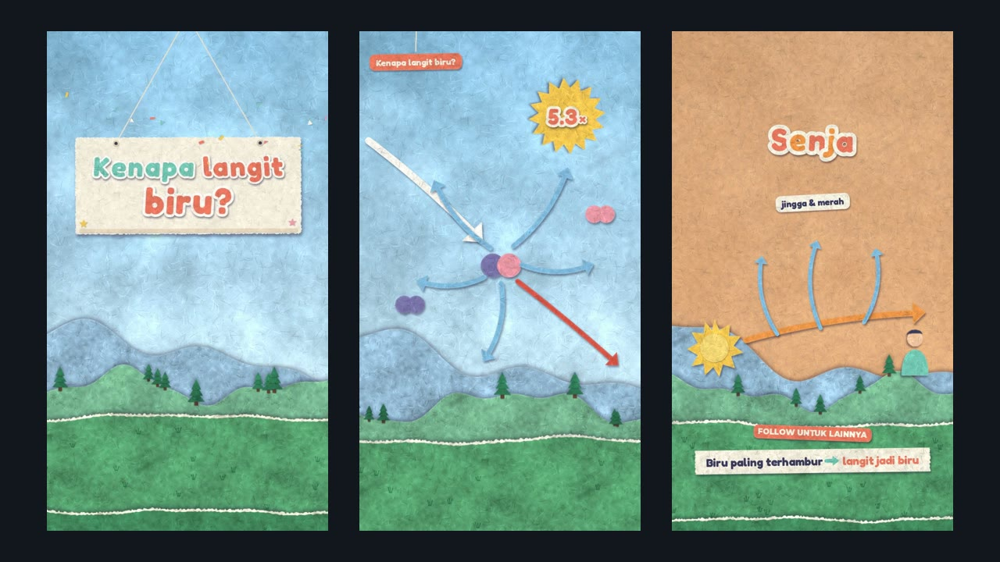

# Motion Papercut

Skill Claude untuk membuat **video explainer bergaya kertas guntingan** (papercraft) langsung dari chat Claude di browser. Kasih topik, naskah, atau rekaman suara, lalu Claude menyusun adegan, merender video, dan memberimu file MP4.



Panduan lengkap dan contoh video: https://www.mujay.web.id/lab/motion-papercut

## Fitur

- Intro papan kertas gantung, lalu chip topik di pojok
- Bukit sobekan kertas, huruf stiker, kartu polaroid, counter, grafik, dan panah
- Musik dan efek suara kertas otomatis
- Subtitle dengan kata kunci yang disorot, plus file `.srt`
- Format 9:16, 16:9, 1:1, atau 4:5 dalam 720p atau 1080p
- Input berupa topik, naskah, atau voice over (ditranskrip offline dengan Whisper)

## Pasang di Claude (browser)

Tidak perlu install apa pun di komputermu.

1. Klik **Code → Download ZIP** di halaman ini. File ZIP tidak perlu diekstrak.
2. Di [claude.ai](https://claude.ai), buka **Settings → Capabilities**.
3. Aktifkan **Code execution and file creation**.
4. Di bagian **Skills**, klik **Upload skill**, lalu pilih file ZIP tadi.

## Cara pakai

Buka chat baru, lalu minta dengan kalimat biasa:

```text
Bikin video explainer gaya kertas tentang kenapa es batu mengapung di air, 45 detik, format 9:16.
```

Claude akan menanyakan pengaturan video sekali, menulis naskah kalau perlu, merender, lalu memberi file MP4 untuk diunduh.

## Isi repository

| Path | Isi |
| --- | --- |
| `SKILL.md` | Instruksi untuk Claude |
| `engine/` | Mesin render (Python), musik, SFX, dan transkrip Whisper |
| `engine/SPEC_REFERENCE.md` | Katalog objek, aksi, dan layout |
| `engine/examples/` | Contoh spec 9:16 dan 16:9 |
| `engine/fonts/` | Fredoka, Montserrat, Rubik (SIL Open Font License 1.1) |
